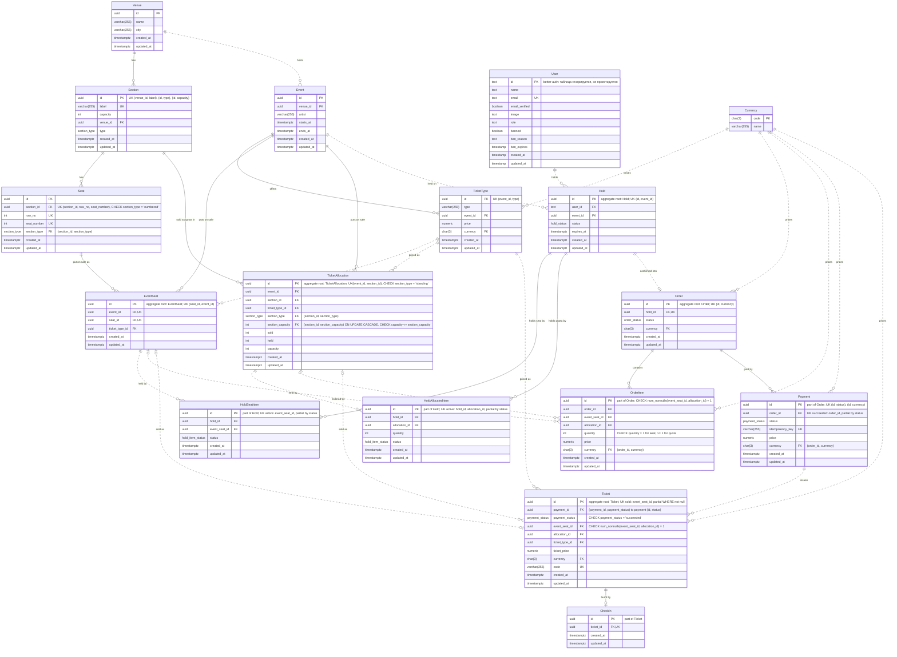

## Кратности

Одна строка на каждую линию `erDiagram` выше. Кратность записана как «родитель : ребёнок»:
левое число — сколько родителей у одной строки ребёнка, правое — сколько детей у одного
родителя. Механизм взят из живой базы (`pg_dump --schema-only` после `0005`), а не из
`*.schema.ts`. Минимум 1 у родителя держится `NOT NULL` на FK, максимум 1 у ребёнка — `UNIQUE`,
максимум N — отсутствием `UNIQUE`. Минимум 1 у ребёнка схема не выражает: он либо не нужен,
либо держится кодом, и тогда это названо.

| Связь | Кратность | Чем держится | Состояние |
| --- | --- | --- | --- |
| `Venue` → `Section` | 1 : 0..N | `section.venue_id NOT NULL`, `section_venue_id_fk` | — |
| `Venue` → `Event` | 1 : 0..N | `event.venue_id NOT NULL`, `event_venue_id_fk` | — |
| `Section` → `Seat` | 1 : 0..N | `seat.section_id NOT NULL`, `seat_section_id_venue_id_fk`; только у `numbered` — `seat_section_id_section_type_fk` + `seat_section_type_ck` | — |
| `Section` → `TicketAllocation` | 1 : 0..N, на событие 0..1 | `ticket_allocation.section_id NOT NULL`, `ticket_allocation_section_id_venue_id_fk`; максимум на событие — `ticket_allocation_event_id_section_id_uq` (N:M `Event × Section`) | — |
| `Event` → `TicketType` | 1 : 0..N | `ticket_type.event_id NOT NULL`, `ticket_type_event_id_fk` | — |
| `Event` → `EventSeat` | 1 : 0..N | `event_seat.event_id NOT NULL`, `event_seat_event_id_venue_id_fk` | — |
| `Event` → `TicketAllocation` | 1 : 0..N | `ticket_allocation.event_id NOT NULL`, `ticket_allocation_event_id_venue_id_fk` | — |
| `Seat` → `EventSeat` | 1 : 0..N, на событие 0..1 | `event_seat.seat_id NOT NULL`, `event_seat_seat_id_venue_id_fk`; максимум на событие — `event_seat_seat_id_event_id_uq` (N:M `Event × Seat`) | — |
| `TicketType` → `EventSeat` | 1 : 0..N | `event_seat.ticket_type_id NOT NULL`, `event_seat_ticket_type_id_event_id_fk` | — |
| `TicketType` → `TicketAllocation` | 1 : 0..N | `ticket_allocation.ticket_type_id NOT NULL`, `ticket_allocation_ticket_type_id_event_id_fk` | — |
| `TicketType` → `Ticket` | 1 : 0..N | `ticket.ticket_type_id NOT NULL`, `ticket_ticket_type_id_fk` — простой FK, без пары с событием | — |
| `Event` → `Hold` | 1 : 0..N | `hold.event_id NOT NULL`, `hold_event_id_fk` | — |
| `User` → `Hold` | 1 : 0..N | `hold.user_id NOT NULL`, `hold_user_id_fk` | — |
| `Hold` → `HoldSeatItem` | 1 : 0..N | `hold_seat_item.hold_id NOT NULL`, `hold_seat_item_hold_id_event_id_fk`. Домен требует хотя бы одну позицию в одной из двух веток — `I-15`, код | — |
| `Hold` → `HoldAllocatedItem` | 1 : 0..N, на квоту 0..1 | `hold_allocated_item.hold_id NOT NULL`, `hold_allocated_item_hold_id_event_id_fk`; максимум на квоту — `hold_allocated_item_hold_id_allocation_id_active_uq`. Минимум — `I-15`, код | максимум действует на `active`; `released` — сколько угодно |
| `Hold` → `Order` | 1 : 0..1 | `order.hold_id NOT NULL`, `order_hold_id_fk`, `order_hold_id_uq` | безусловно: заказ в любом статусе занимает холд |
| `EventSeat` → `HoldSeatItem` | 1 : 0..N, активных 0..1 | `hold_seat_item.event_seat_id NOT NULL`, `hold_seat_item_event_seat_id_event_id_fk`; максимум — `hold_seat_item_event_seat_id_active_uq` | максимум действует на `active`, по всем холдам; `released` — история, сколько угодно |
| `TicketAllocation` → `HoldAllocatedItem` | 1 : 0..N | `hold_allocated_item.allocation_id NOT NULL`, `hold_allocated_item_allocation_id_event_id_fk`. Разные холды держат одну квоту одновременно — это и есть квота | — |
| `Order` → `OrderItem` | 1 : 0..N | `order_item.order_id NOT NULL`, `order_item_order_id_currency_fk`. Домен требует хотя бы одну позицию — `I-38`, код | — |
| `Order` → `Payment` | 1 : 0..N, успешных 0..1 | `payment.order_id NOT NULL`, `payment_order_id_currency_fk`; максимум — `payment_order_id_succeeded_uq` | максимум действует на `succeeded`; `pending` и `failed` — сколько угодно |
| `EventSeat` → `OrderItem` | 0..1 : 0..N | nullable `order_item_event_seat_id_fk` + `order_item_event_seat_id_allocation_id_ck` (ровно одна ссылка). В одном заказе место не больше одного раза — `order_item_order_id_event_seat_id_uq` (`I-39`) | — |
| `TicketAllocation` → `OrderItem` | 0..1 : 0..N | nullable `order_item_allocation_id_fk` + тот же `CHECK`. В одном заказе квота не больше одного раза — `order_item_order_id_allocation_id_uq` (`I-39`) | — |
| `Payment` → `Ticket` | 1 : 0..N | `ticket.payment_id NOT NULL`, `ticket_payment_id_payment_status_fk` на `payment (id, status)` + `ticket_payment_status_ck` | детей может иметь только `succeeded`-платёж |
| `EventSeat` → `Ticket` | 0..1 : 0..1 | nullable `ticket_event_seat_id_fk`, `ticket_event_seat_id_uq` (partial, `WHERE event_seat_id IS NOT NULL`) | безусловно, пока нет возврата (см. `M1-10`) |
| `TicketAllocation` → `Ticket` | 0..1 : 0..N | nullable `ticket_allocation_id_fk` + `ticket_event_seat_id_allocation_id_ck` | — |
| `Ticket` → `CheckIn` | 1 : 0..1 | `check_in.ticket_id NOT NULL`, `check_in_ticket_id_fk`, `check_in_ticket_id_uq` | — |
| `Currency` → `TicketType` | 1 : 0..N | `ticket_type.currency NOT NULL`, `ticket_type_currency_fk` | — |
| `Currency` → `Order` | 1 : 0..N | `order.currency NOT NULL`, `order_currency_fk` | — |
| `Currency` → `OrderItem` | 1 : 0..N | транзитивно: `order_item_order_id_currency_fk` на `order (id, currency)`, дальше `order_currency_fk`. Прямого FK на `currency` нет | — |
| `Currency` → `Payment` | 1 : 0..N | транзитивно: `payment_order_id_currency_fk` на `order (id, currency)`, дальше `order_currency_fk` | — |
| `Currency` → `Ticket` | 1 : 0..N | `ticket.currency NOT NULL`, `ticket_currency_fk` | — |

**N:M и их связки.** `Event × Seat` — `event_seat`, `Event × Section` — `ticket_allocation`:
`UNIQUE` на паре есть у обеих. `Hold × EventSeat` (`hold_seat_item`) и
`Hold × TicketAllocation` (`hold_allocated_item`) уникальны только среди `active`, строки
`released` — история. `Order × EventSeat` и `Order × TicketAllocation` — одна связка `order_item` с двумя
`UNIQUE` на паре (`I-39`). Оба ключа обычные: `NULL` в них по умолчанию различны, поэтому
строки квот с пустым `event_seat_id` не сталкиваются друг с другом. `NULLS NOT DISTINCT`
сломал бы заказ из двух квот.

## Агрегаты

Граница помечена комментарием у первичного ключа (решение 10): `aggregate root: X` у корня,
`part of X` у сущности внутри. Пять агрегатов из [CONTEXT.md](../../CONTEXT.md):

| Агрегат (root)       | Таблицы внутри                             | Рядом, но снаружи — ссылка по id                            |
| -------------------- | ------------------------------------------ | ------------------------------------------------------------- |
| **EventSeat**        | `event_seat`                               | `seat`, `event`, `ticket_type`, `hold_seat_item`, `ticket`    |
| **TicketAllocation** | `ticket_allocation`                        | `event`, `section`, `ticket_type`, `hold_allocated_item`      |
| **Hold**             | `hold`, `hold_seat_item`, `hold_allocated_item` | `user`, `event_seat`, `ticket_allocation`, `order`       |
| **Order**            | `order`, `order_item`, `payment`           | `hold`, `event_seat`, `ticket_allocation`, `ticket`           |
| **Ticket**           | `ticket`, `check_in`                       | `payment`, `event_seat`, `ticket_allocation`, `ticket_type`   |

**Сущности без пометки живут вне агрегатов** — `venue`, `section`, `seat`, `ticket_type`,
`currency`, `user`. Это не упущение: они не защищают инвариантов при записи, и по разделу
«Где DDD не применяется» им положен обычный CRUD.

**`user` отличается от остальных ещё и тем, что мы его не проектировали.** Таблицу владеет
better-auth (решено 2026-09-22, миграция `0003_auth`): схема генерируется командой
`pnpm auth:schema` и руками не правится. Отсюда три отличия от остального документа, которые
надо видеть, а не считать опечаткой:

- **`id` — `text`**, а не `uuid`; поэтому `hold.user_id` тоже `text`;
- **времена — `timestamp` без таймзоны.** Опции, задающей тип, у drizzle-адаптера нет. В
  **наших** таблицах по-прежнему только `timestamptz`, и это исключение названо здесь, чтобы на
  ревью `M1-06` оно не выглядело недосмотром;
- **имя одно (`name`), а не `first_name` + `last_name`**, и `role` — свободный `text` от плагина
  `admin`, а не enum. Значения ролей (`buyer`, `organizer`, `scanner`, `admin`) задаются кодом в
  `M3-03`, а не типом в базе.

Остальные таблицы better-auth — `session`, `account`, `verification`, `rate_limit` — на этой
диаграмме отсутствуют сознательно: это инфраструктура аутентификации, домена они не касаются и
ни одной доменной связи не несут.

Два места, где граница проведена сознательно и будет обосновываться в `M1-13`:

- **Инвариант `EventSeat` держится строкой чужого агрегата.** «Место удерживается не более
  чем одним активным Hold» физически стоит на `hold_seat_item`, а тот лежит внутри `Hold` —
  так решено, чтобы у `Hold` осталось что проверять для инварианта «Hold непустой». Это и есть
  «главное напряжение проекта» из `CONTEXT.md`, только увиденное со стороны схемы.
- **`payment` внутри `Order`.** Словарь кладёт платежи в заказ, и правила «оплаченный нельзя
  оплатить второй раз» и «нельзя вернуть неоплаченный» живут с ним в одном агрегате. Цена:
  webhook провайдера, меняющий статус платежа, приходит извне и в чужой момент времени, а
  писать обязан через агрегат `Order`.

## Инварианты

Чем держится каждый инвариант из таблицы «Агрегаты и их инварианты» — в
[states-and-invariants.md](./states-and-invariants.md), раздел «Пункт 10». Там же расписаны
состояния `hold_status`, `hold_item_status`, `payment_status`, `order_status` с разрешёнными
переходами и все принятые решения по схеме с их ценой.

Коротко: из инвариантов `CONTEXT.md` схемой держатся все, кроме шести. Четыре живут в коде
агрегата осознанно — «Hold непустой» и «истёкший Hold нельзя подтвердить» невыразимы в
принципе, переходы `Order.status` enum не описывает, возврата в `M1` нет. Пятый —
совпадение валюты билета с валютой платежа — оставлен тесту, чтобы не вешать второй составной
ключ на ту же таблицу. Шестой снят вместе с колонкой: `total` не хранится.
